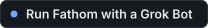
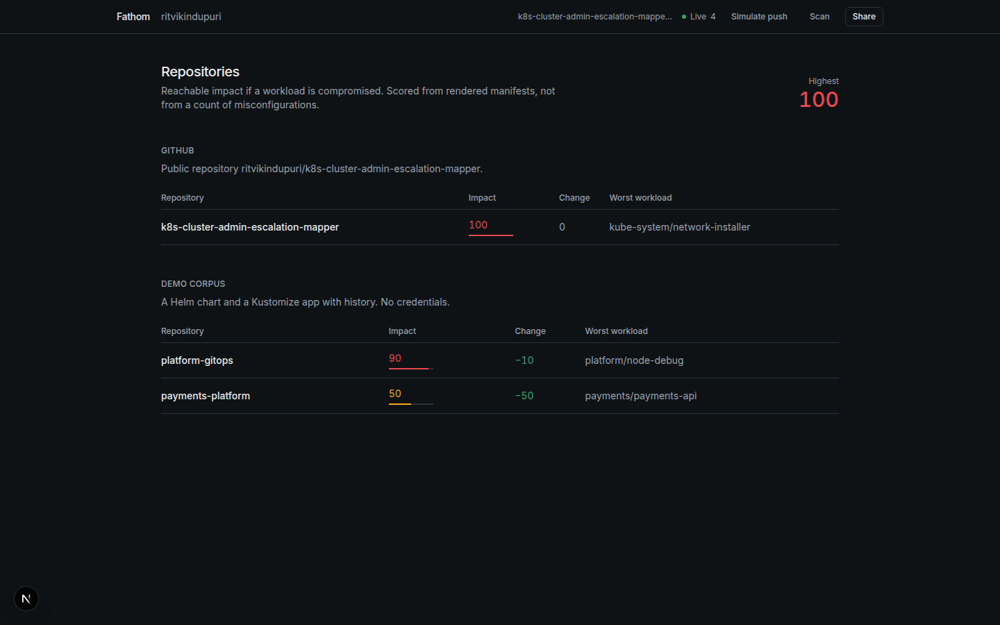
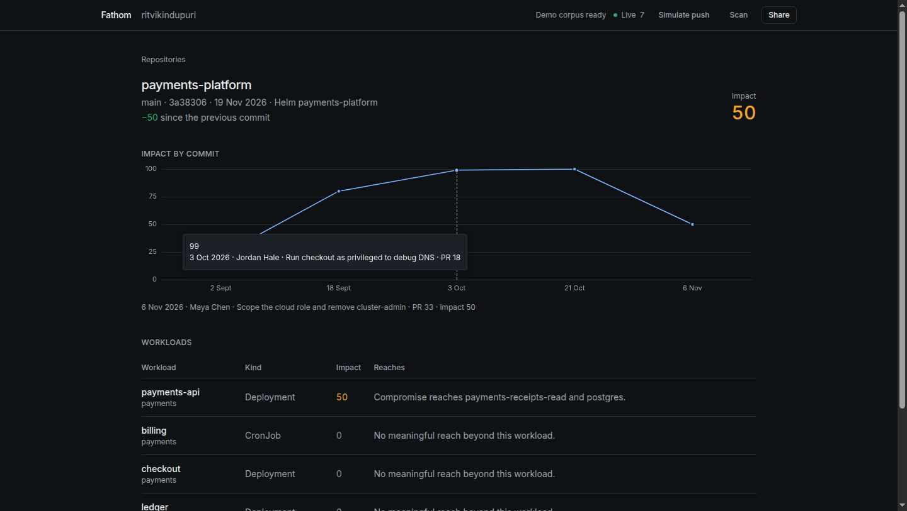
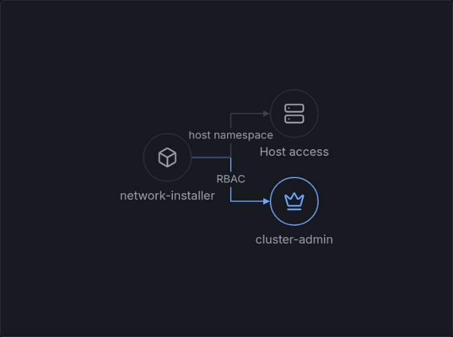
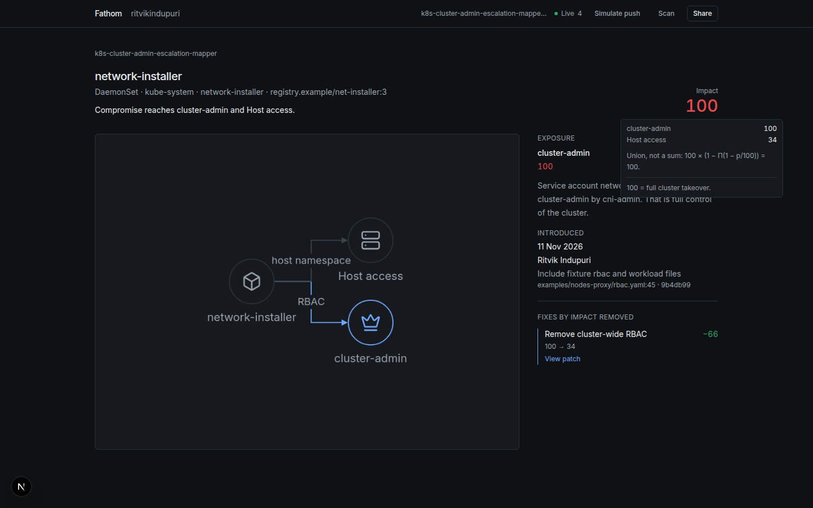
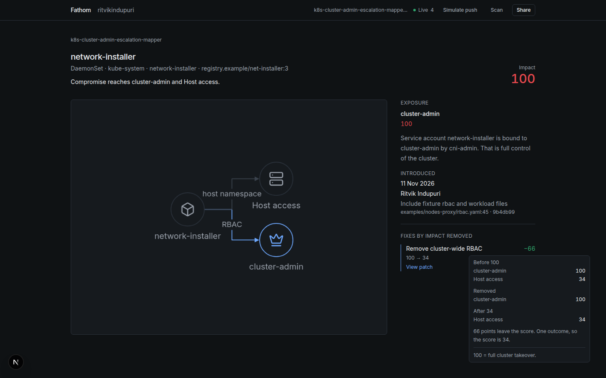
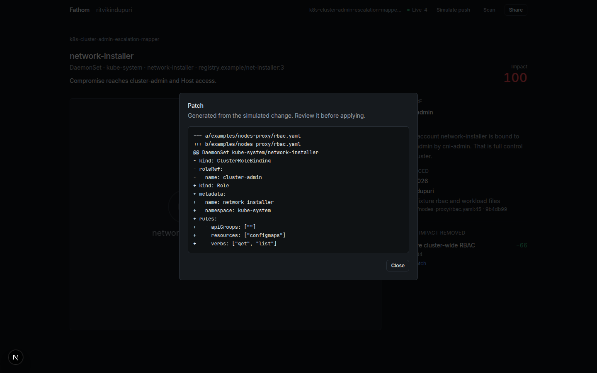
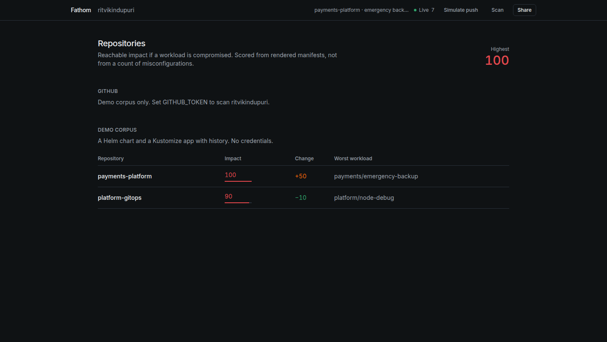
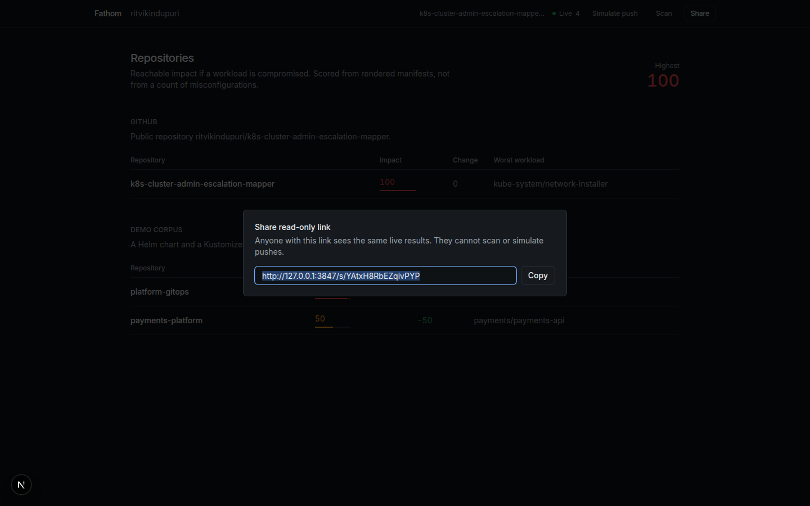
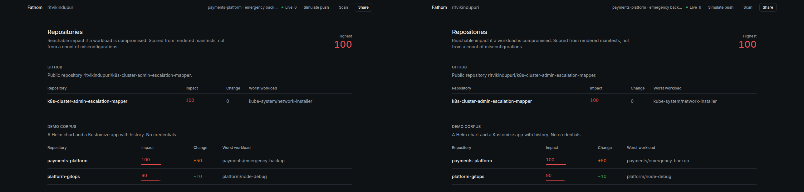

<p align="center">
  <picture>
    <source media="(prefers-color-scheme: dark)" srcset="docs/brand/fathom-logo-dark.svg" />
    
  </picture>
</p>

<p align="center"><strong>Blast radius from Kubernetes config.</strong></p>

<p align="center">
  <a href="https://x.ai/bot/4RdqcByKgClTdbKMdWWP3"></a>
</p>

Fathom answers what an attacker could reach after compromising one workload, using only the manifests in a repository. It renders Helm charts and Kustomize overlays, then scores each workload by the union of reachable outcomes: cluster-admin and other RBAC, mounted and committed secrets, host access, network exposure, and cloud identity. The repository score is the worst workload, not a count of failed checks.

Every score can be hovered to see the factors and how they combine. Every exposure is blamed to the commit that introduced the evidence line. Suggested fixes are re-scored and ranked by how much blast radius they remove. The dashboard is shared and live: a read-only link follows the same stream, so two viewers see a scan or a simulated push together.

It runs with no credentials. A local demo corpus (a Helm chart and a Kustomize app, with git history) loads on first start. A public GitHub repository can be scanned by URL with no token. `GITHUB_TOKEN` is what discovery, pull-request lookup, and polling use. It is not what checks a webhook: that is `GITHUB_WEBHOOK_SECRET`. Discovery does not list every repository. With a token, **Scan** keeps at most eight public non-fork repositories of `GITHUB_OWNER` whose trees look like Kubernetes manifests.

## Key features

- **Blast radius, not a finding count.** Each reachable outcome has its own impact. The workload score is the union, so one path to cluster-admin is 100 and five minor gaps do not add up to the same thing. Scale: 100 is full cluster takeover. Severity bands are critical at 85, high at 65, medium at 35, and low below that.
- **Attack chain.** The workload view draws the path from the workload to the assets it can reach. Nodes are icons (workload, crown for cluster-admin, shield for other RBAC, key for a secret, server for the node, cloud, network, account) with a short label. The selected path is cyan.
- **Provenance.** Each exposure names the file, line, commit, author, date, and pull request when history provides one. A per-repository chart shows whether impact is rising or falling across commits.
- **Fix ranking.** Candidate edits are applied to the model one at a time and re-scored. They are kept only when the workload drops by at least 5 points, then listed by points removed. Each one can show a patch. Hover the delta to see the before and after factors.
- **Live shared dashboard.** Server-sent events push one snapshot to every open tab. The header shows a live dot and the viewer count. **Share** mints a read-only link. Viewers on that link cannot scan or simulate pushes.
- **Public repository by URL.** `POST /api/scan` with a GitHub URL clones that repository read-only and adds it to the dashboard. No token.
- **Discovery, webhooks, and polling.** With `GITHUB_TOKEN`, **Scan** discovers up to eight public non-fork repositories of `GITHUB_OWNER` that contain Kubernetes manifests. A push signed with `GITHUB_WEBHOOK_SECRET` rescans the repository when the payload owner is `GITHUB_OWNER`. Polling also needs the token, not the webhook secret. Every `POLL_INTERVAL_MS` (default 120000, and `0` turns it off) it compares the default-branch SHA of GitHub repositories already on the dashboard, whether or not a webhook is set.
- **Demo mode.** Two repositories with real git history are created under `.data` on first launch. **Simulate push** toggles an emergency cluster-admin CronJob on `payments-platform` and every viewer updates.

Outcomes the model scores include cluster-admin, kubelet `nodes/proxy`, pods/exec, cluster and namespace secret reads, a committed secret, privileged and host-namespace pods, a runtime socket hostPath, hostPort, hostNetwork, cross-namespace exposure, and cloud roles from IRSA, GKE workload identity, and Azure workload identity annotations. `kind: List` documents and JSON manifests are expanded. The analyzer never copies secret values into the API response.

## System architecture

<p align="center">
  
</p>

The editable source of the figure is [`docs/images/architecture.svg`](docs/images/architecture.svg). GitHub, Helm, Kubernetes, Kustomize, and Docker are shown with their product marks.

1. Repositories enter from GitHub, or from the local demo corpus. The inputs are Helm charts, Kustomize overlays, and Kubernetes manifests.
2. The scanner clones that repository read-only and renders what is inside it: Helm charts, Kustomize overlays, and loose YAML or JSON manifests that are not already inside a chart or overlay. A JSON file is read only when it contains `"apiVersion"`.
3. The scoring engine walks each workload and combines reachable outcomes into one score from 0 to 100. The formula is `100 × (1 − Π(1 − impact / 100))`. The worst path dominates.
4. Provenance runs after scoring. It blames the evidence line to a commit. The timeline is the last 12 commits, oldest first. A pull-request number is read from a `Demo-PR:` line in the commit body, or, with a token, from the GitHub pulls API for at most eight commits.
5. The live stream sends the new snapshot to every connected dashboard over server-sent events.
6. The browser shows the overview first. Opening a repository shows the timeline. Opening a workload shows the attack chain, the provenance of the selected exposure, and the ranked fixes.
7. Those stages are one process. Docker Compose is how that process is packaged for a laptop or a persistent Linux host. The container restarts unless you stop it, and clones, demo history, the score cache, and share links stay on a volume. The same compose file is used in both places. `npm run dev` runs the same process with no container. The browser is outside that box either way.

## Tech stack

| Area | Components |
| --- | --- |
| Application | Next.js 16 (App Router), React 19, TypeScript 5 |
| Interface | Tailwind CSS 4, Radix UI (dialog, tooltip, separator, slot), Inter |
| Attack graph | Cytoscape 3, cytoscape-dagre, dagre. Node icons from the Lucide set |
| Timeline chart | Apache ECharts 6 |
| Manifests | Helm 3 and Kustomize 5 on `PATH`. The image pins Helm 3.16.4 and Kustomize 5.5.0. Manifests are parsed with the `yaml` package. git reads history |
| Live updates | Server-sent events, an in-memory snapshot, share tokens stored on disk |
| GitHub | Read-only clone and the REST API for discovery, the default branch, and pull requests. HMAC-signed push webhooks |
| Runtime | Node.js 22. Docker Compose for the local and persistent-host install. The image is a multi-stage build that installs git, Helm, and Kustomize |
| Tests | Vitest 4, ESLint 9 |

Data written at runtime lives in `.data` (gitignored): demo repositories, clones, the score cache, and share links. In Docker that directory is the `fathom-data` volume, mounted at `/app/.data`.

## Setup

### Run Fathom with a Grok Bot

This is the easiest start. Import the template [K8s Blast Radius](https://x.ai/bot/4RdqcByKgClTdbKMdWWP3). On that page, choose **Add to Grok Bot**. That opens the Grok Bot app, which finishes the import and creates a copy on your account. If the app is not installed, the same page has **Download**. The page says the bot was created by a third-party user, not by SpaceXSI.

The imported bot asks which repositories to watch, and whether to run Fathom on its own computer (always on) or locally.

Local Docker, local npm, and a persistent Linux host below are the alternative: clone this repository and run the dashboard yourself. The demo still needs no token. The server listens on port **3847**.

### Local, with Docker

Mac, Linux, or Windows with Docker Desktop.

```bash
git clone https://origin.cursor.com/git/ritvik-indupuri/tmp-da7d143fe8c6b9b4.git FathomK8
cd FathomK8
docker compose up -d
```

Open http://127.0.0.1:3847. The container restarts unless you stop it (`docker compose stop`). Logs: `docker compose logs -f`. The `fathom-data` volume keeps demo history, clones, and share links across restarts.

The image is built from the Dockerfile: Node 22, git, Helm 3.16.4, and Kustomize 5.5.0. The first `docker compose up -d` builds that image, which is the slow step, then starts `node server.js`. The server does not compile on startup.

### Local, without Docker

Node.js 22, git, Helm 3, and Kustomize 5 on `PATH`.

Mac or Linux:

```bash
git clone https://origin.cursor.com/git/ritvik-indupuri/tmp-da7d143fe8c6b9b4.git FathomK8
cd FathomK8
./run.sh
```

`./run.sh` installs dependencies on first run, then starts the dev server.

Windows, in Command Prompt or PowerShell:

```bat
git clone https://origin.cursor.com/git/ritvik-indupuri/tmp-da7d143fe8c6b9b4.git FathomK8
cd FathomK8
npm install
npm run dev
```

The dev server listens on http://127.0.0.1:3847. A production build is `npm run build` and `npm start`.

### Persistent Linux host

Same compose file. Clone the repository on the host and leave it running:

```bash
git clone https://origin.cursor.com/git/ritvik-indupuri/tmp-da7d143fe8c6b9b4.git FathomK8
cd FathomK8
docker compose up -d
```

Put TLS in front of port 3847 before the host is reachable on the public internet. Inside the container the server listens on `0.0.0.0` and port 3847 (`HOSTNAME` and `PORT`). Share links and the webhook URL should use the public host name, not `127.0.0.1`.

Update later with:

```bash
git pull
docker compose up -d --build
```

### Token

A token is optional. Public repositories scan by URL with no token, and the demo corpus still loads when discovery is skipped.

To discover up to eight of `GITHUB_OWNER`'s public non-fork repositories that contain Kubernetes manifests, and to ask GitHub which pull request merged a commit, create a fine-grained or classic token with read access to repository contents, metadata, and pull requests. Copy the example file and set the token. Do not commit it.

Docker (compose reads `.env` in the project directory):

```bash
cp .env.example .env
```

npm (Next reads `.env.local`):

```bash
cp .env.example .env.local
```

```bash
GITHUB_TOKEN=github_pat_xxx
GITHUB_OWNER=ritvikindupuri
GITHUB_WEBHOOK_SECRET=
POLL_INTERVAL_MS=120000
```

Restart after changing these (`docker compose up -d`, or stop the dev server and run `./run.sh` again). Then press **Scan**. Without `GITHUB_TOKEN`, **Scan** refreshes the demo corpus and leaves public repositories that are still in memory. It does not discover repositories. On a fresh start the GitHub section reads `Demo corpus only. Set GITHUB_TOKEN to scan ritvikindupuri.` After a URL scan it reads `Public repository <owner>/<name>.` **Scan** does not change that sentence. Restarting the process drops URL-scanned repositories from the dashboard. The clone stays in `.data/clones` until you post the URL again. Share links are read back from `.data/shares.json`.

| Variable | Required | Purpose |
| --- | --- | --- |
| `GITHUB_TOKEN` | No | Discover up to eight repositories, read pull requests, and poll. Never placed in the clone URL |
| `GITHUB_OWNER` | No | GitHub user to discover, and the only owner a webhook will rescan. Default `ritvikindupuri` |
| `GITHUB_WEBHOOK_SECRET` | Only for webhooks | HMAC secret. If it is unset, the webhook route returns 503. A bad signature returns 401 |
| `POLL_INTERVAL_MS` | No | Milliseconds between SHA checks when `GITHUB_TOKEN` is set. Default `120000`. `0` turns polling off |

### Scan a repository by URL

No token. From the machine that is running Fathom:

```bash
curl -s -X POST http://127.0.0.1:3847/api/scan \
  -H 'content-type: application/json' \
  -d '{"url":"https://github.com/owner/repo"}'
```

`https://github.com/owner/repo`, `github.com/owner/repo.git`, and `owner/repo` are accepted. Fathom asks GitHub for the default branch, clones with depth 30 into `.data/clones/owner/repo`, and adds the repository to the overview. The header reads `<repo> scanned` when it finishes.

`POST /api/scan` with an empty body, or JSON that has no `url`, does what the **Scan** button does: refresh the demos, and discover `GITHUB_OWNER` when a token is set.

### Webhook

Create a GitHub webhook on the repository.

- Payload URL: `https://<your-host>/api/webhooks/github`
- Content type: `application/json`
- Secret: the same value as `GITHUB_WEBHOOK_SECRET`
- Event: Pushes

A signed push whose repository owner is `GITHUB_OWNER` reclones that repository and updates every open dashboard. Pushes for any other owner, and branch deletions, are ignored. A ping is accepted. Polling does not use `GITHUB_WEBHOOK_SECRET`. It runs only when `GITHUB_TOKEN` is set, including when a webhook is also configured.

### Tests

```bash
npm test
```

The engine tests cover the union score, cluster-admin versus a namespaced read, node escape, kubelet proxy, `kind: List`, JSON manifests, egress, cloud roles, secret redaction, and fix order. Webhook signatures are covered separately. `npm run lint` runs ESLint.

## Usage

Open http://127.0.0.1:3847. The first paint says "Scanning manifests…" until the demo corpus is ready.

### Overview

The header is on every page: the word **Fathom** (the home link), the owner name (`GITHUB_OWNER`, default `ritvikindupuri`), the latest event, a green live dot, and the viewer count. The normal dashboard has three actions: **Simulate push**, **Scan**, and **Share**. A share link hides all three. The browser tab icon is the hexagon mark. The event text is hidden below the large breakpoint.



1. Read the sentence under **Repositories**. The number at the right is the highest repository score. Hover it. The tooltip lists the winning workload's factors, the union formula, the note "Repository score is the highest workload.", and the line "100 = full cluster takeover."
2. The **GitHub** section is empty of rows until a URL scan or a token discovery adds one. After a URL scan it names the repository, as in the screenshot (`ritvikindupuri/k8s-cluster-admin-escalation-mapper`, score 100, worst workload `kube-system/network-installer`).
3. The **Demo corpus** section lists `payments-platform` (Helm) and `platform-gitops` (Kustomize). Each row shows impact, the change since the previous commit, and the worst workload.
4. Hover any impact number in the table for the same breakdown.
5. Click a repository name. That opens the repository view.

### Repository and timeline



1. The crumb **Repositories** returns to the overview.
2. The title is the repository. Under it: branch, seven-character commit, scan time, and renderer notes. Those notes look like `Helm payments-platform`, `Kustomize overlays/prod`, or `Manifest <file>`. Notes that say the renderer failed are omitted from this line. The impact at the right is the worst workload. Hover it.
3. When there is an earlier commit, a line shows the change since that commit. It is orange (`#f76808`) when the score rose, green when it fell, and muted when it did not change. On a fresh demo, `payments-platform` is 50 and that change is −50. `platform-gitops` is 90 and that change is −10.
4. **Impact by commit** is the timeline. Hover a point. The tooltip shows the score, then the date, author, subject, and `PR <n>` when one was found. Click a point to pin that commit. The line under the chart then reads that caption plus `impact <score>`. Until you click, the line is the latest commit.
5. **Workloads** lists every rendered workload, highest impact first. The columns are name and namespace, kind, impact (hover for factors), and a one-line reach summary.
6. A repository with no workloads says "No workloads in the rendered manifests." A committed secret is called out in red above the chart. Secret values are not shown.
7. Click a workload name.

### Workload, attack graph, and provenance



1. The crumb is the repository name and returns to the timeline.
2. The title is the workload. Under it: kind, namespace, service account, and image. The sentence is the reach summary. **Impact** is this workload's score.
3. The graph is the attack chain. Icons, in one set: a cube is the workload, a crown is cluster-admin, a shield is other RBAC, a key is a secret, stacked servers are the node, a cloud is a cloud role, a network node is an exposed service, and a person is an account. Labels sit under the icon. Hover a node for the longer caption.
4. The cyan icon and the cyan edges are the selected exposure. Click another node to select it. The panel on the right follows the selection.
5. **Exposure** names the selected outcome and its points, then explains it in a sentence.
6. **Introduced** is the provenance: date, author, commit subject, pull request when known, and `file:line` plus the short SHA. `network-installer`'s cluster-admin binding is `examples/nodes-proxy/rbac.yaml:45`. Host network on the same file is line 69. If git has no blame, the panel says "No git provenance for this line."
7. A workload with nothing reachable shows "No reachable assets from this workload."

### Score tooltips

Hover the impact number.



The tooltip lists each factor and its points, then how they combine. Two outcomes use the union, not a sum: `100 × (1 − Π(1 − p/100))`. One outcome states that the score is that outcome. None states that the score is 0. The footer is always "100 = full cluster takeover." The same tooltip is on the overview and on every workload row.

### Fix ranking

Under **Fixes by impact removed**, each row is an edit that shrinks this workload by at least 5 points. The largest shrink is listed first. A cyan bar marks the first fix that removes the selected exposure. If none of them do, the bar stays on the first fix.



1. Read the title, for example "Remove cluster-wide RBAC".
2. Hover the green shrink (here −66). The tooltip shows the factors before, the factors the fix removes, the factors after, and the union of what remains.
3. The line under the title is the score before and after (`100 → 34`). Host network is still there, so the score does not fall to 0.
4. Click **View patch**. A dialog shows the diff generated from the simulated change. It tells you to review the patch before applying. **Close** dismisses it. Nothing is written to the repository.



If no edit helps, the panel says "No config change reduces this score."

### Scan by URL

There is no URL field in the dashboard. Scanning a public repository is the curl command in Setup. When it returns, the header event becomes `<repo> scanned` and the repository appears under **GitHub** on the overview. Click it and walk the timeline and workloads the same way as a demo repository.

The **Scan** button in the header does not take a URL. It refreshes the demo corpus. If `GITHUB_TOKEN` is set, it also discovers `GITHUB_OWNER`. While a scan is running the button reads **Scanning** and both **Scan** and **Simulate push** are disabled.

### Simulate push

**Simulate push** is on the header of the normal dashboard. It is hidden on a share link.

1. Note `payments-platform`. In the demo it is 50, and the worst workload is `payments/payments-api`.
2. Click **Simulate push**.
3. The header event becomes `payments-platform · emergency backup added`. That repository's score becomes 100, the change column shows `+50`, and the worst workload becomes `payments/emergency-backup`. Every open dashboard updates together.



4. Click **Simulate push** again. The event becomes `payments-platform · emergency backup reverted` and the score returns to 50. Each click writes a new commit on the local demo: one adds `templates/emergency-backup.yaml` (a cluster-admin CronJob), the next deletes that file. It does not push to GitHub.

### Share links

1. Click **Share**.
2. The dialog is titled "Share read-only link". The field is an absolute URL of the form `http://<host>/s/<token>`.
3. Click **Copy**. The button label becomes **Copied**.
4. Open the URL in another browser. You see the same repositories, timeline, and workloads. **Simulate push**, **Scan**, and **Share** are absent. The live dot still counts this viewer.
5. An unknown token says "This link is not valid."



Share links survive a restart because they are stored in `.data` (or the Docker volume).

### Two viewers

The header count is the number of open dashboards on this server, including share links.

1. Open the dashboard in two windows.
2. Both show the same repositories and the same live count.
3. In one window, click **Simulate push**.
4. Both windows change together: the header event, `payments-platform`'s score, and the worst workload. You do not reload.



A webhook push or a URL scan updates the same way. If the connection drops, the dot turns amber and the label reads **Reconnecting** until the stream returns.
