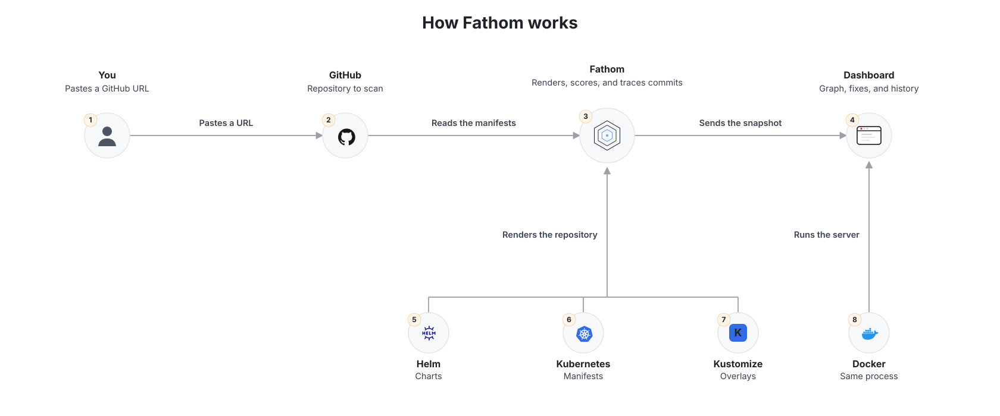

<p align="center">
  <picture>
    <source media="(prefers-color-scheme: dark)" srcset="docs/brand/fathom-logo-dark.svg" />
    
  </picture>
</p>

<p align="center"><strong>Blast radius from Kubernetes config.</strong></p>

<p align="center">
  <a href="https://x.ai/bot/4RdqcByKgClTdbKMdWWP3"></a>
</p>

Fathom scores how much of a cluster an attacker could reach from one workload. It only scans a GitHub repository you paste. History, commits, and later updates come from that repository.

## Key features

- **Blast radius.** 0–100 for one workload. 0–34 low, 35–64 moderate, 65–84 high, 85–100 critical.
- **Attack graph.** The path from that workload to the cluster access, secrets, node, network, and cloud identity it can reach.
- **Real git history.** Each reason is blamed to the commit that introduced the line. The chart is the last 12 commits on the branch.
- **Fixes.** Edits that lower the score by at least 5 points, with a patch. Nothing is written to the repository.
- **Live updates.** Fathom polls the branch HEAD and rescans when it changes. A signed GitHub push webhook does the same.

## How it works

<p align="center">
  
</p>

1. You paste a GitHub URL and press **Scan**.
2. Fathom clones that repository read-only.
3. Helm, Kustomize, and plain YAML or JSON manifests are rendered.
4. Each workload is scored. `git blame` and `git log` supply the commit, author, and pull request.
5. The dashboard updates. Polling, or a signed push webhook, rescans when that branch HEAD moves.

Source: [`docs/images/architecture.svg`](docs/images/architecture.svg).

## Tech stack

| Area | Components |
| --- | --- |
| App | Next.js 16, React 19, TypeScript 5, Tailwind CSS 4 |
| Graph and chart | Cytoscape, dagre, Apache ECharts 6 |
| Render | Helm 3, Kustomize 5, git. The image pins Helm 3.16.4 and Kustomize 5.5.0 |
| Live | Server-sent events. Polls `git ls-remote` for the real branch HEAD |
| Runtime | Node.js 22. Docker Compose for a laptop or a host. Port 3847 |

Runtime data is in `.data` (gitignored): clones, score cache, the list of scanned repositories, and share links.

## Setup

Import the [K8s Blast Radius](https://x.ai/bot/4RdqcByKgClTdbKMdWWP3) Grok Bot and choose **Add to Grok Bot**, or run it yourself. The server listens on port **3847**.

### Docker

```bash
git clone https://github.com/ritvikindupuri/FathomK8.git FathomK8
cd FathomK8
docker compose up -d
```

Open http://127.0.0.1:3847. Helm and Kustomize are in the image. Stop with `docker compose stop`. Logs: `docker compose logs -f`.

On a host, use the same commands and put TLS in front of port 3847 before it is public. Update with `git pull` and `docker compose up -d --build`.

### Without Docker

Node.js 22, git, Helm 3, and Kustomize 5 on `PATH`. `./run.sh` warns if `helm` or `kustomize` is missing, then starts anyway. A missing tool fails that render with `spawn helm ENOENT` or `spawn kustomize ENOENT`.

`brew install helm` installs Helm 4. Use Helm 3:

macOS:

```bash
brew install helm@3 kustomize
brew link --force --overwrite helm@3
```

Linux:

```bash
curl -fsSL https://raw.githubusercontent.com/helm/helm/main/scripts/get-helm-3 | bash -s -- --version v3.16.4
curl -fsSL -o /tmp/install_kustomize.sh https://raw.githubusercontent.com/kubernetes-sigs/kustomize/master/hack/install_kustomize.sh
sudo bash /tmp/install_kustomize.sh 5.5.0 /usr/local/bin
```

The Kustomize script will not replace an existing `/usr/local/bin/kustomize`. Remove that file first if you are installing again.

Windows (winget):

```bat
winget install --id Helm.Helm -e --version 3.16.4 --accept-package-agreements --accept-source-agreements
winget install --id Kubernetes.kustomize -e --version 5.5.0 --accept-package-agreements --accept-source-agreements
```

Windows (Chocolatey):

```bat
choco install kubernetes-helm --version=3.16.4 -y
choco install kustomize --version=5.5.0 -y
```

Open a new terminal so both tools are on `PATH`.

Mac or Linux:

```bash
git clone https://github.com/ritvikindupuri/FathomK8.git FathomK8
cd FathomK8
./run.sh
```

Windows:

```bat
git clone https://github.com/ritvikindupuri/FathomK8.git FathomK8
cd FathomK8
npm install
npm run dev
```

Dev server: http://127.0.0.1:3847. Production: `npm run build` then `npm start`.

### Options

A token is optional. Public repositories scan without one. Set `GITHUB_TOKEN` to raise the GitHub rate limit, read pull requests, and clone private repositories you can access.

```bash
cp .env.example .env        # Docker Compose reads .env
cp .env.example .env.local  # Next.js reads .env.local
```

| Variable | Required | Purpose |
| --- | --- | --- |
| `GITHUB_TOKEN` | No | Rate limit, pull requests, and private clones. Never put it in a clone URL |
| `GITHUB_WEBHOOK_SECRET` | Only for webhooks | HMAC secret. Unset returns 503. A bad signature returns 401 |
| `POLL_INTERVAL_MS` | No | How often to read each scanned branch HEAD. Default `120000`. `0` turns polling off |

Restart after changing these. Repositories you have scanned are fetched again on startup. Until then the page is empty.

```bash
curl -s -X POST http://127.0.0.1:3847/api/scan \
  -H 'content-type: application/json' \
  -d '{"url":"https://github.com/owner/repo"}'
```

`https://github.com/owner/repo`, `github.com/owner/repo.git`, and `owner/repo` are accepted. This is the request the **Scan** button sends.

Webhook: payload URL `https://<your-host>/api/webhooks/github`, content type `application/json`, the same secret, event **Pushes**. A signed push rescans that repository only if you already scanned it. A ping is accepted. Polling does not use the webhook secret.

## Usage

1. Open http://127.0.0.1:3847. If you have not scanned anything, the page tells you to paste a repository.
2. Paste a GitHub URL and press **Scan**. The button reads **Scanning** until the clone finishes, then that repository opens. One to try: `https://github.com/ritvikindupuri/k8s-cluster-admin-escalation-mapper`.
3. Use the repository menu to switch repositories, or **All repositories** to go home.
4. **Overview** is the repository list, or the timeline inside a repository. **Workloads**, **Attack graph**, and **Fixes** open the selected repository. On the home page they open the highest-risk repository once one exists.
5. Hover a blast radius. The tooltip says what 0–100 means, the band, and the reasons with the points each one adds. Those reasons do not add together. The score stays at or below 100.
6. **Share** copies a read-only link. Someone with the link sees the same results as they update. They cannot scan or create another link.
